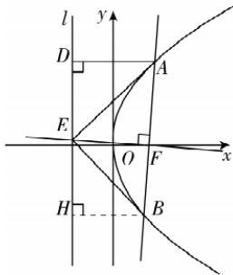

> [!faq]- 答案与解析
>
> > [!success]- **【答案】** ACD
>
> > [!note]- **【解析】**
> > 由题意可得 $F\left(\frac{3}{2},0\right)$ ，直线 l 即为抛物线 C 的准线。由抛物线的定义可得 $|AD| = |AF|$ ，故 A 正确。
> >
> > 当 $AB \perp x$ 轴时， $A\left(\frac{3}{2},3\right)$ ， $B\left(\frac{3}{2},-3\right)$ ， $E\left(-\frac{3}{2},0\right)$ ， $|AB| = 6$ ， $|AE| = 3\sqrt{2}$ ，此时 $|AE| \neq |AB|$ ，故 B 错误。
> >
> > 由抛物线的性质可得，当 AB 垂直于 x 轴时， $|AB|$ 最小，此时 AB 为抛物线的通径，则有 $|AB| \geqslant 6$ ，故 C 正确。
> >
> > 巧思：设 $\angle AFx = \theta$ ，则 $|AB| = \frac{2p}{\sin^{2}\theta} = \frac{6}{\sin^{2}\theta} \geqslant 6$ 过点 B 作 l 的垂线，垂足为 H。由 $EF \perp AB$ 可得 $\angle AFE = \frac{\pi}{2}$ ，又 $\angle ADE = \frac{\pi}{2}$ ， $|AD| = |AF|$ ，所以 $\angle DEA = \angle FEA$ 。同理可得 $\angle FEB = \angle HEB$ ，故 $\angle AEB = \frac{1}{2} (\angle DEF + \angle FEH) = \frac{\pi}{2}$ ，在 Rt $\triangle AEB$ 中，EF 为 AB 边上的高，所以 $|AE||BE| = |AB||EF|$ ，当 E 为 l 与 x 轴的交点且 AB 为抛物线的通径时， $|AB| \cdot |EF|$ 取得最小值，最小值为 $3 \times 6 = 18$ ，故 $|AE| \cdot |BE| \geqslant 18$ ，故 D 正确。
> >
> > 巧思：利用补角思想可知 $\angle FEH = \theta$ ，则 $|EF| = \frac{p}{\sin\theta}$ ，所以 $|AE| \cdot |BE| = |AB| \cdot |EF| = \frac{2p}{\sin^{2}\theta} \cdot \frac{p}{\sin\theta} = \frac{2p^{2}}{\sin^{3}\theta} = \frac{18}{\sin^{3}\theta} \geqslant 18$ 故选 ACD。
> >
> > 
> >
> > 链接教材 本题是教材第 135 页例 4 的变式与延伸, 考查抛物线焦点弦问题, 特别注意垂直于对称轴的弦(通径)是最短的焦点弦, 记住常用二级结论可以加速求解.
