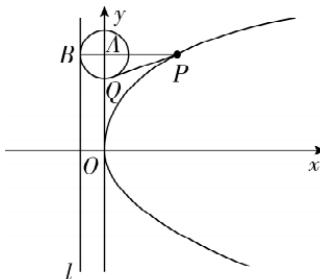

> [!faq]- 答案与解析
>
> > [!success]- **【答案】** ABD
>
> > [!note]- **【解析】**
> > ∵ $y^{2}=4x$ ，∴ 准线 l 为直线 x=-1，∵ ⊙A 圆心为 A(0,4)，半径为 1，作出抛物线与 ⊙A 如图所示。∴ l 与 ⊙A 相切，故 A 正确。当 P，A，B 三点共线时，∵ A(0,4)，∴ P 点坐标为 (4,4)，∵ |PA|=4，|AQ|=1，∴ |PQ| = $\sqrt{4^{2}-1} = \sqrt{15}$ ，故 B 正确。当 |PB|=2 时，P 点坐标为 (1,2) 或 (1,-2)。当 P 点坐标为 (1,2) 时，点 B 坐标为 (-1,2)，|PA| = $\sqrt{1^{2}+(4-2)^{2}} = \sqrt{5} = |AB|$ ，而 |PB|=2， $|PA|^{2} + |AB|^{2} \neq |PB|^{2}$ ，此时 PA 与 AB 不垂直；当 P 点坐标为 (1,-2) 时，B 点坐标为 (-1,-2)，|PA| = $\sqrt{1^{2}+(4+2)^{2}} = \sqrt{37} = |AB|$ ，而 |PB|=2，则 $|PA|^{2} + |AB|^{2} \neq |PB|^{2}$ ，此时 PA 与 AB 也不垂直，故 C 错误。对于 D，设 $P(x_{0},y_{0})$ ，则 $B(-1,y_{0})$ ，∵ |PA|=|PB|，∴ |PA|² = |PB|²，则 $x_{0}^{2} + (y_{0} - 4)^{2} = (x_{0} + 1)^{2}$ ，又点 P 在抛物线上，∴ $y_{0}^{2} = 4x_{0}$ ，代入整理可得 $y_{0}^{2} - 16y_{0} + 30 = 0$ ，解得 $y_{0} = 8 \pm \sqrt{34}$ ，∴ 满
> >
> > ③思： $\Delta = 16^{2} - 4 \times 1 \times 30 = 136 > 0$ ，故方程有两个不等实根
> >
> > 足 |PA| = |PB| 的点 P 有且仅有 2 个，故 D 正确。故选 ABD。
> >
> > 
> >
> > 多种解法 对于 D, 设抛物线 C 的焦点为 F, 则 $F(1,0)$ 且 $|PB| = |PF|$ .
> > ∵ $|PA| = |PB|$ , ∴ $|PA| = |PF|$ ,
> > ∴ 满足 $|PA| = |PF|$ 的点在线段 AF 的垂直平分线上，设线段 AF 的中点为 M，∵ A(0,4)，F(1,0)，∴ $M\left(\frac{1}{2},2\right)$ ，则线段 AF 的垂直平分线的方程为 $y-2=\frac{1}{4}\left(x-\frac{1}{2}\right)$ ，即 $x-4y+\frac{15}{2}=0$ ，联立 $\left\{\begin{aligned}x-4y+\frac{15}{2}&=0,\\ y^{2}&=4x,\end{aligned}\right.$ 消去x 可得 $y^{2}-16y+30=0,\because\Delta>0,\therefore$ 满足 $\left|PA\right|=\left|PB\right|$ 的点 P 有且仅有 2 个, D 正确.
