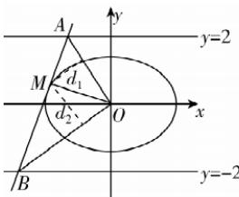

> [!faq]- 答案与解析
>
> > [!success]- **【答案】** 见解析
>
> > [!note]- **【解析】**
> > (1)由题可得 $\left\{\begin{aligned}&2a=4,\\ &\frac{c}{a}=\frac{\sqrt{2}}{2},\end{aligned}\right.$ 解得 $\left\{\begin{aligned}a=2,\\ c=\sqrt{2},\end{aligned}\right.$ 所以 $b^{2}=a^{2}-c^{2}=2$ ，所以椭圆方程为 $\frac{x^{2}}{4}+\frac{y^{2}}{2}=1$ .
> > (2)由点 $M(x_{0},y_{0})$ 是椭圆上一点，得 $\frac{x_{0}^{2}}{4}+\frac{y_{0}^{2}}{2}=1$ ，即 $x_{0}^{2}+2y_{0}^{2}-4=0$ ，将点 M 的坐标代入直线方程，得 $x_{0}^{2}+2y_{0}^{2}-4=0$ ，所以直线恒过点 M.
> > → 点 悟：由直线方程为 $\frac{x_{0}x}{4} + \frac{y_{0}y}{2} = 1$ 及点 $M(x_{0}, y_{0})$ 在椭圆上可得直线是椭圆在点 M 处的切线
> > 设点 M 到 OA 的距离为 $d_{1}$ ，点 M 到 OB 的距离为 $d_{2}$ ，
> > 则 $\frac{S_{1}}{S_{2}}=\frac{\frac{1}{2}|OA|d_{1}}{\frac{1}{2}|OB|d_{2}}=\frac{|OA|}{|OB|}\cdot\frac{d_{1}}{d_{2}}$ ，故只需确定 $\frac{d_{1}}{d_{2}}$ 与 1 的大小关系即可.
> >
> > 
> >
> > 将 $y = 2$ 代入 $x_0x + 2y_0y - 4 = 0$ ，得 $x_{A} = \frac{4 - 4y_{0}}{x_{0}}$ ，则 $A\left(\frac{4 - 4y_0}{x_0},2\right)$ 当 $y_{0} = 1$ ，即 $A(0,2)$ 时，直线 $OA$ 的方程为 $x = 0$ ；当 $y_{0}\neq 1$ 时，设 $OA$ 所在直线方程为 $y = k_{1}x$ ，则 $\frac{4 - 4y_0}{x_0} k_1 = 2$ ，解得 $k_{1} = \frac{x_{0}}{2 - 2y_{0}}$ ，即 $OA$ 所在直线方程为 $y = \frac{x_0}{2 - 2y_0} x(y_0\neq 1)$ ，即 $x_0x - (2 - 2y_0)\cdot$ $y = 0(y_0\neq 1)$ ，且当 $y_{0} = 1$ 时， $x = 0$ 也满足 $x_0x - (2 - 2y_0)y = 0$ ，故 $OA$ 所在直线的方程为 $x_0x - (2 - 2y_0)y = 0.$ 同理可得 $OB$ 所在直线方程为 $y = \frac{-x_0}{2 + 2y_0} x,$ 即 $x_0x + (2 + 2y_0)y = 0.$ 由 $\frac{x_0^2}{4} +\frac{y_0^2}{2} = 1$ ，得 $x_0^2 = 4 - 2y_0^2$ ，且 $|y_0|\leqslant$ $\sqrt{2}$
> >
> > 所以 $d_{1}=\frac{|x_{0}^{2}-(2-2y_{0})y_{0}|}{\sqrt{x_{0}^{2}+(2-2y_{0})^{2}}}$ $=\frac{|4-2y_{0}^{2}-2y_{0}+2y_{0}^{2}|}{\sqrt{4-2y_{0}^{2}+4+4y_{0}^{2}-8y_{0}}}$ $=\frac{|4-2y_{0}|}{\sqrt{2y_{0}^{2}-8y_{0}+8}}=\frac{|4-2y_{0}|}{\sqrt{2(y_{0}-2)^{2}}}$ $=\frac{2(2-y_{0})}{\sqrt{2}(2-y_{0})}=\sqrt{2}$ $d_{2}=\frac{|x_{0}^{2}+(2+2y_{0})y_{0}|}{\sqrt{x_{0}^{2}+(2+2y_{0})^{2}}}$ $=\frac{|4-2y_{0}^{2}+2y_{0}+2y_{0}^{2}|}{\sqrt{4-2y_{0}^{2}+4+4y_{0}^{2}+8y_{0}}}$ $=\frac{|4+2y_{0}|}{\sqrt{2y_{0}^{2}+8y_{0}+8}}$ $=\frac{|4+2y_{0}|}{\sqrt{2(y_{0}+2)^{2}}}=\frac{2|y_{0}+2|}{\sqrt{2}|y_{0}+2|}=\sqrt{2}$ 所以 $\frac{d_{1}}{d_{2}}=1$ ，所以 $\frac{S_{1}}{S_{2}}=\frac{|OA|}{|OB|}$ .
