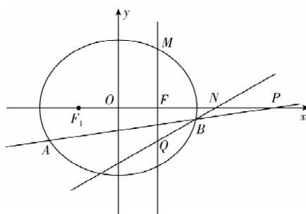

> [!faq]- 答案与解析
>
> > [!success]- **【答案】** 见解析
>
> > [!note]- **【解析】**
> > 设椭圆 C 的左焦点为 $F_{1}$ ，因为点 M 的横坐标为 1，且 $MF \perp x$ 轴，所以 c=1，则 $|F_{1}F|=2, |MF|=\frac{3}{2}$ .
> > 因为 $MF \perp x$ 轴，所以 $|MF_{1}| = \sqrt{|MF|^{2} + |F_{1}F|^{2}} = \frac{5}{2}$ ，所以 $2a = |MF_{1}| + |MF| = 4$ ，解得 a = 2，所以 $b^{2} = a^{2} - c^{2} = 3$ ，
> > 故椭圆 C 的方程为 $\frac{x^{2}}{4}+\frac{y^{2}}{3}=1$ .
> > (2)【证明】设 $A(x_{1},y_{1}), B(x_{2},y_{2})$ ， $\overrightarrow{AP} = \lambda \overrightarrow{PB} (\lambda \neq -1 \text{ 且 } \lambda \neq 1)$ ，则 $\left\{\begin{aligned}\frac{x_{1}+\lambda x_{2}}{1+\lambda}&=4,\\ \frac{y_{1}+\lambda y_{2}}{1+\lambda}&=0,\end{aligned}\right.$ 即 $\left\{\begin{aligned}\lambda x_{2}&=4+4\lambda-x_{1},\\ \lambda y_{2}&=-y_{1}.\end{aligned}\right.$ 又由 $\left\{\begin{aligned}3x_{1}^{2}+4y_{1}^{2}&=12①,\\ 3(\lambda x_{2})^{2}+4(\lambda y_{2})^{2}&=12\lambda^{2}②,\end{aligned}\right.$ ①-②可得 $3 \cdot \frac{x_{1} + \lambda x_{2}}{1 + \lambda} \cdot \frac{x_{1} - \lambda x_{2}}{1 - \lambda} + 4 \cdot \frac{y_{1} + \lambda y_{2}}{1 + \lambda} \cdot \frac{y_{1} - \lambda y_{2}}{1 - \lambda} = 12$ ，结合上式可得 $5\lambda - 2\lambda x_{2} + 3 = 0.$ 由 $N\left(\frac{5}{2},0\right), B(x_{2},y_{2})$ ，得直线 BN 的方程为 $y=\frac{y_{2}}{x_{2}-\frac{5}{2}}\cdot\left(x-\frac{5}{2}\right)$ ，
> > 因为点 Q 是直线 BN 与直线 MF 的交点，所以将点 Q 的横坐标 1 代入直线 BN 的方程得 $y_{Q}=\frac{3y_{2}}{5-2x_{2}}=\frac{3\lambda y_{2}}{5\lambda-2\lambda x_{2}}=-\lambda y_{2}=y_{1}$ ，故 $AQ \perp y$ 轴.
> >
> > 
> >
> > 多种解法 设 $A(x_{1},y_{1}),B(x_{2},y_{2})$ 由 $P,A,B$ 三点共线得 $x_{1}y_{2} - x_{2}y_{1} = 4(y_{2} - y_{1})$ ①，所以 $(x_{1}y_{2} - x_{2}y_{1})\cdot (x_{1}y_{2} + x_{2}y_{1}) = x_{1}^{2}y_{2}^{2} - x_{2}^{2}y_{1}^{2} =$ $\left(4 - \frac{4}{3} y_1^2\right)y_2^2 -\left(4 - \frac{4}{3} y_2^2\right)y_1^2 = 4(y_2-$ $y_{1})(y_{2} + y_{1}) = 4(y_{2} - y_{1})\cdot (x_{1}y_{2}+$ $x_{2}y_{1})$ ，即 $x_{1}y_{2} + x_{2}y_{1} = y_{2} + y_{1}$ ②，①②联立得 $2x_{2}y_{1} = 5y_{1} - 3y_{2}$ 由 $N\left(\frac{5}{2},0\right),B(x_2,y_2)$ ，得直线BN的方程为 $y = \frac{y_2}{x_2 - \frac{5}{2}}\cdot \left(x - \frac{5}{2}\right)$ ，因为点 $Q$ 是直线BN与直线MF的交点，所以将点 $Q$ 的横坐标1代入直线BN的方程得 $y_{Q} = \frac{3y_{2}}{5 - 2x_{2}} =$ $\frac{3y_1y_2}{5y_1 - 2y_1x_2} = y_1$ ，故 $AQ\bot y$ 轴.
