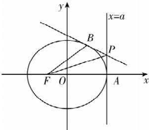

> [!faq]- 答案与解析
>
> > [!success]- **【答案】** 见解析
>
> > [!note]- **【解析】**
> > 由题意可设 $P(a, y_0)(y_0 > 0)$ , $\because F(-c, 0), A(a, 0), k_{PF} = \frac{1}{3}, S_{\triangle PFA} = \frac{3}{2}, e = \frac{1}{2},$ $\left\{ \begin{array}{l} \frac{y_0}{a + c} = \frac{1}{3}, \\ \frac{1}{2}(a + c) \cdot y_0 = \frac{3}{2}, \\ \frac{c}{a} = \frac{1}{2}, \end{array} \right.$ 解得 $\left\{ \begin{array}{l} a = 2, \\ c = 1, \\ y_0 = 1, \end{array} \right.$ $\therefore b^2 = a^2 - c^2 = 3.$ $\therefore$ 椭圆的方程为 $\frac{x^2}{4} + \frac{y^2}{3} = 1.$ (2)【证明】由(1)知 $P(2, 1)$ , 易知直线 $PB$ 的斜率一定存在, 设直线 $PB$ 的方程为 $y = k(x - 2) + 1$ , 联立 $\left\{ \begin{array}{l} y = k(x - 2) + 1, \\ \frac{x^2}{4} + \frac{y^2}{3} = 1, \end{array} \right.$ 得 $(3 + 4k^2)x^2 + 8k(1 - 2k)x + 8(2k^2 - 2k - 1) = 0①$ , 直线 $PB$ 与椭圆有唯一公共点, $\therefore \Delta = 96(2k + 1) = 0$ , 解得 $k = -\frac{1}{2}$ ,代入①中得 $x^{2}-2x+1=0$ ，解得 x=1，
> > 则 $B\left(1,\frac{3}{2}\right)$ .
> > 解法一: 又∵ $F(-1,0)$ , $A(2,0)$ ,
> > ∴ $\overrightarrow{FB}=\left(2,\frac{3}{2}\right),\overrightarrow{FP}=(3,1)$ ,
> > ∴ $\cos\angle BFP = \cos\langle\overrightarrow{FB},\overrightarrow{FP}\rangle = \frac{\overrightarrow{FB}\cdot\overrightarrow{FP}}{|\overrightarrow{FB}||\overrightarrow{FP}|}=\frac{3\sqrt{10}}{10}.$ 在 Rt $\triangle FAP$ 中， $\cos\angle AFP=\frac{|FA|}{|FP|}=$ $\frac{3\sqrt{10}}{10}.$ ∴ $\angle AFP = \angle BFP$ ,
> > ∴ PF 平分 $\angle AFB$ .
> >
> > 
> >
> > 解法二：∵ $B\left(1,\frac{3}{2}\right)$ , $F(-1,0)$ , $\therefore k_{BF}=\frac{\frac{3}{2}-0}{1+1}=\frac{3}{4}$ ，即 $\tan\angle BFA=\frac{3}{4}$ . $\because \tan \angle PFA = \frac{1}{3}, \therefore \tan 2 \angle PFA = \frac{2 \times \frac{1}{3}}{1 - \left(\frac{1}{3}\right)^2} = \frac{3}{4},$ $\therefore \tan \angle BFA = \tan 2 \angle PFA, \therefore \angle BFA = 2 \angle PFA,$ 故 PF 平分 $\angle AFB.$
> >
> > 链接教材 本题是教材第114页例7的变式与延伸,考查直线与椭圆的位置关系,一般转化为研究直线方程与椭圆方程组成的方程组解的个数问题求解.
