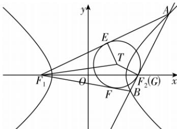

> [!faq]- 答案与解析
>
> > [!success]- **【答案】** 见解析
>
> > [!note]- **【解析】**
> > 设 $AF_{1},F_{1}B,AB$ 与内切圆的切点分别为 E, F, G, 令 $|AE|=|AG|=m, |BG|=|BF|=n,$ $|F_{1}F|=|F_{1}E|=t(m,n,t>0)$ ，则 $|AF_{1}|+$ $|F_{1}B|-|AB|=(m+t+n+t)-(m+n)=2t=2a\times2$ , 得 t=2a, $\therefore |AF_{1}|-|AG|=2a, |BF_{1}|-|BG|=2a$ ，由双曲线定义得 $|AF_{1}|-|AF_{2}|=|BF_{1}|-|BF_{2}|=2a$ ，则点 G 与点 $F_{2}$ 重合，又 $|TG|=|TE|$ ，则 $(x_{T}-c)^{2}+y_{T}^{2}=|TE|^{2}=|TF_{1}|^{2}-|EF_{1}|^{2}=(x_{T}+c)^{2}+y_{T}^{2}-4a^{2}$ ，即 $x_{T}=\frac{a^{2}}{c}=\frac{4\sqrt{7}}{7}$ 。又∵ $k_{AB}=2$ ， $\therefore k_{GT}=-\frac{1}{2},\therefore$ 直线 GT 的方程为 $y=-\frac{1}{2}(x-\sqrt{7}),\therefore y_{T}=-\frac{1}{2}\times\left(\frac{4\sqrt{7}}{7}-\sqrt{7}\right)=\frac{3\sqrt{7}}{14},\therefore T\left(\frac{4\sqrt{7}}{7},\frac{3\sqrt{7}}{14}\right).$
> >
> > 
