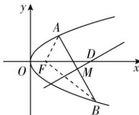

> [!faq]- 答案与解析
>
> > [!success]- **【答案】** 2
>
> > [!note]- **【解析】**
> > 设 $A(x_{1},y_{1})$ , $B(x_{2},y_{2})$ ，线段 AB 的中点为 $M(x_{0},y_{0})$ ，易知直线 AB 的斜率存在且不为 0.
> > 设直线 AB 的斜率为 $k(k \neq 0)$ ，则 $\left\{\begin{aligned}y_{1}^{2}&=2px_{1},\\ y_{2}^{2}&=2px_{2}\end{aligned}\right.\Rightarrow y_{1}^{2}-y_{2}^{2}=2p(x_{1}-x_{2})$ ，故 $k=\frac{y_{1}-y_{2}}{x_{1}-x_{2}}=\frac{2p}{y_{1}+y_{2}}=\frac{p}{y_{0}}.$ 则 $k_{MD}=\frac{y_{0}-0}{x_{0}-4}=\frac{y_{0}}{x_{0}-4}=-\frac{y_{0}}{p}\Rightarrow x_{0}=4-p.$ 设 C 的焦点为 F，连接 AF, BF，则有 $\left|AF\right|+\left|BF\right|=x_{1}+x_{2}+p=2x_{0}+p=8-p.$ 又因为 $|AB|$ 的最大值为 6，所以根据抛物线性质和三角形三边关系知， $|AB|\leqslant|AF|+|BF|=8-p=6$ （当且仅当点 F 在线段 AB 上时等号成立），则 p=2.
> >
> > 
