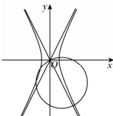

> [!faq]- 答案与解析
>
> > [!success]- **【答案】** B
>
> > [!note]- **【解析】**
> > 由圆 $x^{2} + y^{2} - 2x + 4y = 0$ 得 $(x - 1)^{2} + (y + 2)^{2} = 5$ ，可得圆心为(1，-2).双曲线 $C:\frac{x^2}{2m} -\frac{y^2}{m + 1} = 1(m > 0)$ 的渐近线方程为 $y = \pm \sqrt{\frac{m + 1}{2m}} x,$ 若圆关于双曲线 $C$ 的一条渐近线对称，则圆心在渐近线上.敲黑板：圆的对称轴必过圆心当 $y = \sqrt{\frac{m + 1}{2m}} x$ 时， $-2 = \sqrt{\frac{m + 1}{2m}}$ ，无解；当 $y = -\sqrt{\frac{m + 1}{2m}} x$ 时，由 $-2 = -\sqrt{\frac{m + 1}{2m}}$ ，解得 $m = \frac{1}{7}$
> >
> > 综上, $m=\frac{1}{7}$ . 故选 B.
> >
> > 
