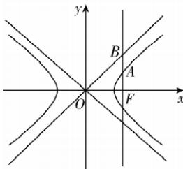

> [!faq]- 答案与解析
>
> > [!success]- **【答案】** $\frac{2\sqrt{3}}{3}$
>
> > [!note]- **【解析】**
> > 双曲线 $\frac{x^2}{a^2} -\frac{y^2}{b^2} = 1(a>$ $0,b > 0)$ 的渐近线方程为 $y = \pm \frac{b}{a} x$
> >
> > 
> >
> > 由 $\left\{\begin{aligned}\frac{x^{2}}{a^{2}}-\frac{y^{2}}{b^{2}}=1,\\ x=c,\end{aligned}\right.$ 解得 $\left\{\begin{aligned}x=c,\\ y=\frac{b^{2}}{a}\text{或}\end{aligned}\right.$ $\left\{\begin{aligned}x=c,\\ y=-\frac{b^{2}}{a},\end{aligned}\right.$ 又 A 在第一象限，故 $A\left(c, \frac{b^2}{a}\right)$ .  
> > 由 $\begin{cases} y = \frac{b}{a} x, \\ x = c, \end{cases}$ 解得 $\begin{cases} x = c, \\ y = \frac{bc}{a}, \end{cases} \therefore B\left(c, \frac{bc}{a}\right)$ . $\because F(c, 0)$ , 点 $A$ 是线段 $FB$ 的中点, $\therefore \frac{2b^2}{a} = \frac{bc}{a}, \therefore c = 2b$ , $\therefore a = \sqrt{c^2 - \frac{1}{4}c^2} = \frac{\sqrt{3}}{2}c$ , $\therefore e = \frac{c}{a} = \frac{2\sqrt{3}}{3}$ .
