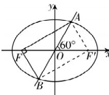

> [!faq]- 答案与解析
>
> > [!success]- **【答案】** A
>
> > [!note]- **【解析】**
> > 如图,作出符合题意的图形,找到椭圆的右焦点 $F'$ , 连接 $AF'$ , $BF'$ , 由椭圆的对称性可得四边形 $AFBF'$ 是平行四边形，因为 $AF \perp BF$ ，所以四边形 $AFBF'$ 是矩形，可得 $|OA| = |OF'| = c$ 。因为直线 $AB$ 的方程为 $y = \sqrt{3}x$ ，所以 $\angle AOF' = 60^\circ$ ，则 $\triangle OAF'$ 是等边三角形。由矩形的性质得 $\angle FAF' = 90^\circ$ ，由等边三角形的性质得 $\angle AF'O = 60^\circ$ ， $|AF'| = c$ ，结合题意可得 $|AF| = \sqrt{3}c$ 。由椭圆的定义得 $|AF'| + |AF| = 2a$ ，则 $c + \sqrt{3}c = 2a$ ，则离心率 $e = \frac{c}{a} = \sqrt{3} - 1$ 。
> >
> > 
> >
> > 故选A.
