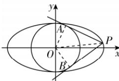

> [!faq]- 答案与解析
>
> > [!success]- **【答案】** C
>
> > [!note]- **【解析】**
> > 如图, 若在椭圆 $C_{1}$ 上存在点 P, 过点 P 作圆的切线 PA, PB, 切点分别为 A, B, 使得 $\angle BPA = \frac{\pi}{3}$ ,
> > 连接 OA, OB, OP,
> > 则 $\angle APO = \angle BPO = \frac{\pi}{6}$ ,
> > 在 Rt△OAP 中， $\angle AOP=\frac{\pi}{3}$ ∴ $\cos\angle AOP=\frac{b}{|OP|}=\frac{1}{2}$ ∴ $|OP|=2b.$ 又 $b<|OP|\leqslant a,\therefore2b\leqslant a,$ ∴ $4b^{2}\leqslant a^{2}$ ，即 $4(a^{2}-c^{2})\leqslant a^{2}$ ，即 $3a^{2}\leqslant4c^{2}$ ，即 $\frac{c^{2}}{a^{2}}\geqslant\frac{3}{4},\therefore e\geqslant\frac{\sqrt{3}}{2}.$ ∵ e<1, ∴ 椭圆 $C_{1}$ 的离心率的取值范围是 $\left[\frac{\sqrt{3}}{2},1\right)$ . 故选 C.
> >
> > 
