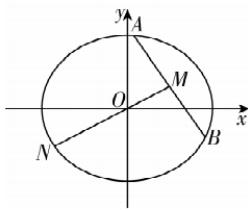

> [!faq]- 答案与解析
>
> > [!success]- **【答案】** AC
>
> > [!note]- **【解析】**
> > 对于 A, 易知 $b = 2\sqrt{3}$ , $\frac{c}{a} = \frac{1}{2}$ , $a^{2} - c^{2} = b^{2}$ , 解得 $a^{2} = 16$ , $c^{2} = 4$ , 所以椭圆 C: $\frac{x^{2}}{16} + \frac{y^{2}}{12} = 1$ , 故 A 正确; 对于 B, 设 $A(x_{1}, y_{1})$ , $B(x_{2}, y_{2})$ , 则 $\left\{\begin{aligned}\frac{x_{1}^{2}}{16} + \frac{y_{1}^{2}}{12 &= 1, \\ \frac{x_{2}^{2}}{16} + \frac{y_{2}^{2}}{12 &= 1,\end{aligned}\right.$ 作 差 得 $\frac{(x_{1}-x_{2})(x_{1}+x_{2})}{16} + \frac{(y_{1}-y_{2})(y_{1}+y_{2})}{12} = 0$ , 即 $\frac{(y_{1}-y_{2})(y_{1}+y_{2})}{(x_{1}-x_{2})(x_{1}+x_{2})} = -\frac{12}{16} = -\frac{3}{4} = \frac{\frac{y_{1}+y_{2}}{2}}{\frac{x_{1}+x_{2}}{2}} \cdot \frac{y_{1}-y_{2}}{x_{1}-x_{2}} = k_{OM} \cdot k_{AB}$ , 易知 $k_{OM} = \frac{1-0}{2-0} = \frac{1}{2}$ , 则 $k_{AB} = -\frac{3}{2}$ , 故 B 错误;
> >
> > 
> >
> > 对于 C, 当 $AB \perp MN$ 时, $k_{OM} \cdot k_{AB} = -1$ , 则 $k_{AB} = -2$ , 则直线 AB 的方程为 $y - 1 = -2(x - 2)$ , 即 $2x + y - 5 = 0$ , 故 C 正确; 对于 D, 当 $AB \perp x$ 轴时, 此时 $l_{AB}: x = 2$ , 不妨设 $A(x_1, y_1)(y_1 > 0)$ , 则 $\frac{y_1^2}{12} = 1 - \frac{x_1^2}{16} = \frac{3}{4}$ , 得 $y_1 = 3$ , 所以 $|AB| = 6$ , 易知 $l_{OM}: y = \frac{1}{2}x$ , 与椭圆 $C: \frac{x^2}{16} + \frac{y^2}{12} = 1$ 联立可得 $x_N^2 = 12$ , 得 $x_N = -2\sqrt{3}$ , 所以 $S_{\triangle ABN} = \frac{1}{2}[2 - (-2\sqrt{3})] \times 6 = 6 + 6\sqrt{3}$ , 故 D 错误. 故选 AC.
