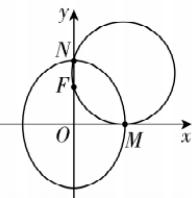

> [!faq]- 答案与解析
>
> > [!success]- **【答案】** B
>
> > [!note]- **【解析】**
> > 由已知可得 $M(b,0)$ , $N(0,a), F(0,c)$ ,
> >
> > 
> >
> > 线段 NF 的垂直平分线方程为 $y = \frac{a + c}{2}$ ，因为过 M, N, F 三点的圆恰与 x 轴相切，所以圆心坐标为 $\left(b, \frac{a + c}{2}\right)$ ，圆的半径为 $\frac{a + c}{2}$ ，所以经过 M, N, F 三点
> >
> > 点悟：与 x 轴的切点是点 M，圆心是线段 NF 的垂直平分线和过点 M 与 x 轴垂直的直线的交点
> >
> > 的圆的方程为 $(x - b)^{2} + \left(y - \frac{a + c}{2}\right)^{2} = \left(\frac{a + c}{2}\right)^{2}$ ， $N(0, a)$ 在圆上，所以 $(0 - b)^{2} + \left(a - \frac{a + c}{2}\right)^{2} = \left(\frac{a + c}{2}\right)^{2}$ ，整理得 $b^{2} = ac$ ，所以 $a^{2} - c^{2} = ac$ ，所以 $c^{2} + ac - a^{2} = 0$ ，化为 $e^{2} + e - 1 = 0$ ，又 0 < e < 1，解得 $e = \frac{\sqrt{5} - 1}{2}$ 。故选 B.
