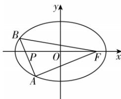

> [!faq]- 答案与解析
>
> > [!success]- **【答案】** 见解析
>
> > [!note]- **【解析】**
> > (1)由题意可得 2b=6, c=4，则 b=3，所以 $a=\sqrt{b^{2}+c^{2}}=5$ ，故椭圆 C 的方程为 $\frac{x^{2}}{25}+\frac{y^{2}}{9}=1$ .
> > (2) 直线 l 的方程为 x=my-3，设点 $A(x_{1}, y_{1}), B(x_{2}, y_{2})$ 联立 $\left\{\begin{aligned}&x=my-3,\\ &\frac{x^{2}}{25}+\frac{y^{2}}{9}=1,\end{aligned}\right.$ 可得 $(9m^{2}+25)\cdot y^{2}-54my-144=0$ 则 $\Delta=(54m)^{2}+4\times(9m^{2}+25)\times144>0$
> >
> > 由根与系数的关系得 $y_{1} + y_{2} = \frac{54m}{9m^{2} + 25}$ ①， $y_{1}y_{2} = -\frac{144}{9m^{2} + 25}$ ②，因为 $S_{\triangle PAF} = 2S_{\triangle PBF}$ ，所以 $\frac{1}{2} \cdot |PF| \cdot |y_{1}| = 2 \cdot \frac{1}{2} \cdot |PF| \cdot |y_{2}|$ ，所以 $y_{1} = -2y_{2} \neq 0$ ③，
> > 避坑：A, B 在 x 轴两侧，列 $y_{1}, y_{2}$ 的关系式时不要忘记加负号
> > 由①②③可得关于 m 的方程为 $\frac{54^{2}m^{2}}{(9m^{2}+25)^{2}}=\frac{72}{9m^{2}+25}$ ，解得 $m^{2}= \frac{50}{63}$ ，即 $m=\pm\frac{5\sqrt{14}}{21}$ . 综上所述，直线 l 的方程为 $x\pm\frac{5\sqrt{14}}{21}y+3=0$ .
> >
> > 
