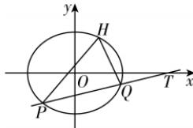

> [!faq]- 答案与解析
>
> > [!success]- **【答案】** 见解析
>
> > [!note]- **【解析】**
> > 由椭圆 $C: \frac{x^2}{a^2} + \frac{y^2}{b^2} = 1 (a > b > 0)$ 的离心率为 $\frac{1}{2}$ , 得 $\frac{\sqrt{a^2 - b^2}}{a} = \frac{1}{2}$ , 则 $\frac{b^2}{a^2} = \frac{3}{4}$ ①. 由椭圆 $C$ 过点 $H\left(1, \frac{3}{2}\right)$ , 得 $\frac{1}{a^2} + \frac{9}{4b^2} = 1$ ②, 联立 ① ② 解得 $a^2 = 4, b^2 = 3$ , 所以椭圆 $C$ 的标准方程为 $\frac{x^2}{4} + \frac{y^2}{3} = 1$ . (2)【解】由 (1) 得 $A(-2,0), B(2,0)$ , 直线 $HA, HB$ 的斜率 $k_{HA} = \frac{\frac{3}{2} - 0}{1 - (-2)} = \frac{1}{2}, k_{HB} = \frac{\frac{3}{2} - 0}{1 - 2} = -\frac{3}{2}$ , 所以直线 $HA, HB$ 的斜率之和为 -1. (3)【证明】由直线 $l_2$ 过点 $T(4,0)$ , 且交椭圆 $C$ 于 $P, Q$ 两点, 得直线 $l_2$ 的斜率存在, 当直线 $l_2$ 的斜率为 0
> >
> > 巧思: 已知直线过 $x$ 轴上的点, 可设横截式方程, 但需要分类讨论斜率是否为 0
> >
> > 时, 其方程为 $y = 0$ , 不妨令点 $P(-2,0), Q(2,0)$ , 由 (2) 知 $k_1 + k_2 = -1$ ; 当直线 $l_2$ 的斜率不为 0 时, 设其方程为 $x = ty + 4, P(x_1, y_1), Q(x_2, y_2)$ , 由 $\begin{cases} x = ty + 4, \\ 3x^2 + 4y^2 = 12, \end{cases}$ 消去 $x$ 并整理得 $(3t^2 + 4)y^2 + 24ty + 36 = 0$ ,
> >
> > 由 $\Delta=(24t)^{2}-144(3t^{2}+4)>0$ , 解得 t<
> >
> > → 避坑：不能忽视直线与椭圆有两个交点时 t 的取值范围
> >
> > -2 或 t>2，则 $y_{1}+y_{2}=-\frac{24t}{3t^{2}+4}$ , $y_{1}y_{2}=$ $\frac{36}{3t^{2}+4}$ ，因此 $k_{1}+k_{2}=\frac{y_{1}-\frac{3}{2}}{x_{1}-1}+\frac{y_{2}-\frac{3}{2}}{(ty_{1}+3)}$ $\frac{y_{2}-\frac{3}{2}}{x_{2}-1}=\frac{y_{1}-\frac{3}{2}}{ty_{1}+3}+\frac{y_{2}-\frac{3}{2}}{ty_{2}+3}$ $\frac{\left(y_{1}-\frac{3}{2}\right)(ty_{2}+3)+\left(y_{2}-\frac{3}{2}\right)(ty_{1}+3)}{(ty_{1}+3)(ty_{2}+3)}$ $\frac{2ty_{1}y_{2}+\left(3-\frac{3}{2}t\right)(y_{1}+y_{2})-9}{t^{2}y_{1}y_{2}+3t(y_{1}+y_{2})+9}$ $\frac{2t\cdot\frac{36}{3t^{2}+4}-\left(3-\frac{3}{2}t\right)\times\frac{24t}{3t^{2}+4}-9}{t^{2}\cdot\frac{36}{3t^{2}+4}-3t\cdot\frac{24t}{3t^{2}+4}+9}$ $\frac{9(t^{2}-4)}{-9(t^{2}-4)}=-1.$ 综上， $k_{1}+k_{2}$ 为定值 -1.
> >
> >   
> > 第3.1节综合训练
> >
> > ## 刷能力
