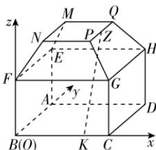

> [!faq]- 答案与解析
>
> > [!success]- **【答案】** A
>
> > [!note]- **【解析】**
> > 以 B 为原点, BC, BA, BF 所在的直线分别为 x, y, z 轴, 建立如图所示的空间直角坐标系 Oxyz, 在正四棱台 EFGH-MNPQ 中, 点 N 到平面$x^{2}=2p_{1}y$ ，则 $2p_{1}=\frac{2^{2}}{4}=1$ ，∴抛物线C的方程为 $x^{2}=y$ .
> > 综上，抛物线 C 的标准方程为 $y^{2}=8x$ 或 $x^{2}=y$ .
> > (2)①【证明】∵抛物线 C 的对称轴为 x 轴，∴ $C: y^{2}=8x$ ，设 $A\left(\frac{y_{1}^{2}}{8},y_{1}\right)$ ， $B\left(\frac{y_{2}^{2}}{8},y_{2}\right)\left(y_{1}\neq y_{2}\right)$ ，∵ $OA\perp OB$ ，∴ $\overrightarrow{OA}\perp \overrightarrow{OB}$ ，∴ $\overrightarrow{OA}\cdot\overrightarrow{OB}=0$ ，即 $\frac{y_{1}^{2}y_{2}^{2}}{64}+y_{1}y_{2}=0$ ，即 $y_{1}y_{2}=-64$ .
> > 当直线 AB 的斜率存在时，直线 AB 的方程为 $\frac{y_{1}-y_{2}}{\frac{y_{1}^{2}}{8}-\frac{y_{2}^{2}}{8}}\left(x-\frac{y_{1}^{2}}{8}\right)+y_{1}=y$ ，即 $y=\frac{8}{y_{1}+y_{2}}\left(x-\frac{y_{1}^{2}}{8}\right)+y_{1}=\frac{8}{y_{1}+y_{2}}x+\frac{y_{1}y_{2}}{y_{1}+y_{2}}=\frac{8}{y_{1}+y_{2}}(x-8)$ ，则直线 AB 过定点 (8,0);
> > 当直线 AB 的斜率不存在时，不妨令点 A 在 x 轴上方，由 $OA \perp OB$ ，可知 $k_{OA}=1=\frac{y_{1}}{\frac{y_{1}^{2}}{8}}=\frac{8}{y_{1}}$ ，即 $y_{1}=8$ ，则 $x_{1}=8$ ，则直线 AB 的方程为 x=8，∴直线 AB 过定点 (8,0).
> > 综上，直线 AB 过定点 (8,0).
> > ②【解】当直线 AB 的斜率存在时，设线段 AB 的中点为 $(x,y)$ ，结合①得 $k_{AB}=\frac{8}{y_{1}+y_{2}}=\frac{8}{2y}=\frac{y-0}{x-8}$ ，即 $y^{2}=4(x-8)$ （ $y\neq0$ ）；当直线 AB 的斜率不存在时，由①知直线 AB 的方程为 x=8，此时线段 AB 的中点为 (8,0)，在曲线 $y^{2}=4(x-8)$ 上.
> > 综上，线段 AB 中点的轨迹方程为 $y^{2}=4(x-8)$ .
> >
> > EFGH 的距离为 $\sqrt{(\sqrt{3})^{2}-(2\sqrt{2}-\sqrt{2})^{2}}=1$ ，由已知可得 $K(3,0,0)$ ， $F(0,0,2)$ ， $N(1,1,3)$ ， $Z(3,2,3)$ ，所以 $\overrightarrow{KZ}=(0,2,3)$ ， $\overrightarrow{FN}=(1,1,1)$ ，因此 $\cos\langle\overrightarrow{KZ},\overrightarrow{FN}\rangle=\frac{\overrightarrow{KZ}\cdot\overrightarrow{FN}}{|\overrightarrow{KZ}||\overrightarrow{FN}|}=\frac{0+2+3}{\sqrt{13}\cdot\sqrt{3}}=\frac{5\sqrt{39}}{39}$ ，
> > 所以异面直线 KZ 与 FN 夹角的余弦值为 $\frac{5\sqrt{39}}{39}$ . 故选 A.
> >
> > 
