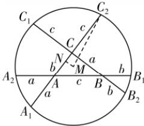

> [!faq]- 答案与解析
>
> > [!success]- **【答案】** A
>
> > [!note]- **【解析】**
> > 因为 a=4, b=3, c=5，即 $a^{2}+b^{2}=c^{2}$ ，所以 $\triangle ABC$ 为直角三角形，且 $\angle ACB=90^{\circ}$ .
> > 设 M 是圆心，因为 $\left|A_{1}C_{2}\right|=\left|A_{2}B_{1}\right|=\left|B_{2}C_{1}\right|=a+b+c=12$ ，所以点 M 到直线 AB, BC, CA 的距离相等，从而 M 是 Rt $\triangle ABC$ 的内心。作 $MN \perp AC$ 于点 N，连接 $MC_{2}$ ，则 $|MN| = |CN| = \frac{3 + 4 - 5}{2} = 1, |NC_{2}| = 6$ ，所以 $|MC_{2}| =$ 点悟： $|MN|=a+b-\frac{a+b+c}{2}=\frac{a+b-c}{2}$ $\sqrt{1^2 + 6^2} = \sqrt{37}$ ，即由 $\triangle ABC$ 生成的康威圆的半径为 $\sqrt{37}$ .故选A.
> >
> > 
