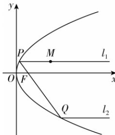

> [!faq]- 答案与解析
>
> > [!success]- **【答案】** BC
>
> > [!note]- **【解析】**
> > 由抛物线的光学性质可知, 直线 PQ 过焦点 $F(1,0)$ , 设直线 $PQ: x = my + 1$ , 代入 $y^{2} = 4x$ 中得 $y^{2} - 4my - 4 = 0, \Delta > 0$ , 则 $y_{1}y_{2} = -4$ , 所以 $(y_{1}y_{2})^{2} = 16x_{1}x_{2} = 16$ ,
> > 所以 $x_{1}x_{2}=1$ ，故 B 正确；
> > 点 P 与 M 均在直线 $l_{1}$ 上，且 $l_{1}//x$ 轴，
> > 则点 P 的坐标为 $\left(\frac{1}{4},1\right)$ ，由 $y_{1}y_{2}=-4$ 得 $y_{2}=-4$ 则点 Q 的坐标为 $(4,-4)$ ，则 $k_{PQ}=\frac{-4-1}{4-\frac{1}{4}}=-\frac{4}{3}$ ，故 A 错误；
> > 由抛物线的定义可知， $|PQ|=x_{1}+x_{2}+p=\frac{1}{4}+4+2=\frac{25}{4}$ ，故 C 正确；
> > 因为 $l_{1}$ 与 $l_{2}$ 平行，所以 $l_{1}$ 与 $l_{2}$ 之间的距离 $d=|y_{1}-y_{2}|=5$ ，故 D 错误.
> > 故选 BC.
> >
> > 
