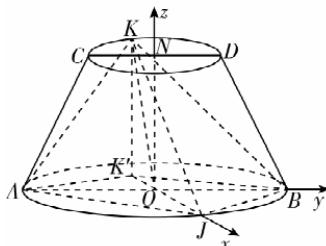

> [!faq]- 答案与解析
>
> > [!success]- **【答案】** 见解析
>
> > [!note]- **【解析】**
> > 因为 K 在下底面的射影为点 $K'$ ，所以 $KK' = ON = 2$ 。又 KA = 3，所以 $AK' = \sqrt{KA^{2} - KK'^{2}} = \sqrt{5}$ 。连接 $OK'$ 。因为上底面圆的直径为 2，所以 $OK' = 1$ ，所以 $OA^{2} + OK'^{2} = AK'^{2}$ ，则 $OA \perp OK'$ ，即 $AB \perp OK'$ 。因为 $KK' \perp$ 平面 $ABJ, AB \subset$ 平面 ABJ，所以 $AB \perp KK'$ 。又 $OK' \cap KK' = K', OK'$ ， $KK' \subset$ 平面 $OKK'$ ，所以 $AB \perp$ 平面 $OKK'$ 。因为 $OK \subset$ 平面 $OKK'$ ，所以 $AB \perp OK$ 。(ii)【解】连接 OJ。因为 OJ = 2， $K'J = 3, K'O = 1$ ，所以 J, O, $K'$ 三点共线。又
> >
> > (2)【解】以 O 为坐标原点，OB, ON 所在的直线分别为 y, z 轴，建立如图所示的空间直角坐标系 Oxyz。由点 $K'$ 的轨迹是下底面上以 O 为圆心，1 为半径的圆，故可设 $\angle K'Ox = \alpha, 0 \leqslant \alpha < 2\pi$ ，
> >
> > 
> >
> > 则 $A(0,-2,0)$ , $B(0,2,0)$ , $K(\cos \alpha, \sin \alpha, 2)$ , $\overrightarrow{AB} = (0,4,0)$ , $\overrightarrow{AK} = (\cos \alpha,$ 敲黑板：点在圆上时可设坐标的三角形式，用角度表示坐标，从而减少计算量
> >
> > $\sin\alpha+2,2)$ . 设平面 ABK 的法向量为 $m=(x,y,z)$ ，则由 $\left\{\begin{aligned}\overrightarrow{AB}\cdot m=0,\\ \overrightarrow{AK}\cdot m=0,\end{aligned}\right.$ 可得 $\left\{\begin{aligned}4y=0,\\ x\cos\alpha+y(\sin\alpha+2)+2z=0,\end{aligned}\right.$ 则 y=0，令 x=2，得 $z=-\cos\alpha$ ，则 $m=(2,0,-\cos\alpha)$ .
> > 由题意可知，平面ABJ的一个法向量为 $n=(0,0,1)$ ， $\cos\langle m,n\rangle=\frac{m\cdot n}{|m||n|}=\frac{-\cos\alpha}{\sqrt{4+\cos^{2}\alpha}}.$ 设二面角 K-AB-J 的大小为 $\theta$ ，则 $\sin^{2}\theta=1-\cos^{2}\langle m,n\rangle=1-\frac{\cos^{2}\alpha}{4+\cos^{2}\alpha}=\frac{4}{4+\cos^{2}\alpha}.$ 因为 $0 \leqslant \cos^{2} \alpha \leqslant 1$ ，所以 $\frac{4}{5} \leqslant \frac{4}{4 + \cos^{2} \alpha} \leqslant 1$ ，则 $\frac{2\sqrt{5}}{5} \leqslant \sin \theta \leqslant 1$ ，则二面角 K-AB-J 的正弦值的最小值为 $\frac{2\sqrt{5}}{5}$ .
