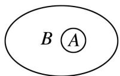
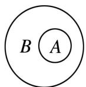
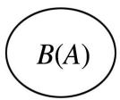
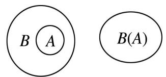
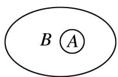

## 知识导学

## 1. Venn 图

用平面上封闭曲线的内部代表集合, 这种图称为 Venn 图. 表示集合的 Venn 图的边界是封闭曲线, 它可以是圆、矩形、椭圆, 也可以是其他封闭曲线. 韦恩图可以直观、形象地表示出集合之间的关系.

## 2. 子集与真子集

（1）子集的定义:对于两个集合 A, B, 如果集合 A 中任意一个元素都是集合 B 中的元素, 就称集合 A 为集合 B 的子集, 记作 $A \subseteq B$ （或 $B \supseteq A$ ），读作 “A 包含于 B”（或 “B 包含 A”）。如果 A 不是 B 的子集，则记作 $A \not\subseteq B$ （或 $B \not\ni A$ ），读作 “A 不包含于 B”（或 “B 不包含 A”）。

(2)真子集的定义:如果集合 A 是集合 B 的子集,并且 B 中至少有一个元素不属于 A,那么集合 A 称为集合 B 的真子集,记作 $A \subsetneq B$ （或 $B \supsetneq A$ ）,读作 “A 真包含于 B”（或 “B 真包含 A”）.

## 3. 集合相等

一般地, 如果集合 A 的任何一个元素都是 B 的元素, 同时集合 B 的任何一个元素都是集合 A 的元素, 那么集合 A 与集合 B 相等, 记作 A = B

## 4. 空集

（1）定义:一般地,我们把不含任何元素的集合叫做空集,记为 $\varnothing$ ,并规定:空集是任何集合的子集,即 $\varnothing\subseteq A$ .

（2）特征：①空集只有一个子集，即它的本身， $\varnothing \subseteq \varnothing$ ；②若 $A \neq \varnothing$ ，则 $\varnothing \subsetneqq A$ 。

(3) 0, {0}, ∅, {∅} 的关系

<table><tr><td></td><td>∅与0</td><td>∅与{0}</td><td>∅与{∅}</td></tr><tr><td>相同点</td><td>都表示无的意思</td><td>都是集合</td><td>都是集合</td></tr><tr><td>不同点</td><td>∅是集合;0是实数</td><td>∅中不含任何元素; $\{0\}$ 含一个元素0</td><td>∅不含任何元素; $\{\emptyset\}$ 含一个元素,该元素是∅</td></tr><tr><td>关系</td><td> $0\notin\emptyset$ </td><td> $\emptyset\subsetneqq\{0\}$ </td><td> $\emptyset\subsetneqq\{\emptyset\}$ 或 $\emptyset\in\{\emptyset\}$ </td></tr></table>
