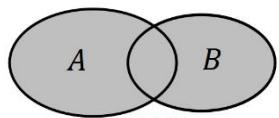
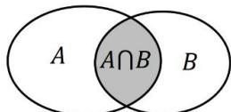
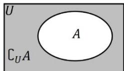

## 知识导学

## 1. 并集的概念与运算

(1) 文字语言: 一般地, 给定两个集合 $A, B$ , 由这两个集合的所有元素组成的集合, 称为 $A$ 与 $B$ 的并集, 记作 $A \cup B$ , 读作 “ $A$ 并 $B$ ”.

（2）符号语言： $A\bigcup B = \{x|x\in A\text{或} x\in B\}$

（3）图形语言:阴影部分为 $A \cup B$

（4）并集的常用运算性质

AUB

<table><tr><td>性质</td><td>定义</td></tr><tr><td> $A \cup B = B \cup A$ </td><td>满足交换律</td></tr><tr><td> $A \cup A = A$ </td><td>任何集合与其本身的并集等于这个集合本身</td></tr><tr><td> $A \cup \varnothing = \varnothing \cup A = A$ </td><td>任何集合与空集的并集等于这个集合本身</td></tr><tr><td> $(A \cup B) \cup C = A \cup (B \cup C)$ </td><td>多个集合的并集满足结合律</td></tr><tr><td> $A \subseteq (A \cup B), B \subseteq (A \cup B)$ </td><td>任何集合都是该集合与另一个集合并集的子集</td></tr><tr><td> $A \subseteq B \Leftrightarrow A \cup B = B$ </td><td>任何集合与它子集的并集都是它本身,反之亦然</td></tr></table>

## 2. 交集的概念与运算

(1) 文字语言: 由所有属于集合 $A$ 且属于集合 $B$ 的元素组成的集合, 称为集合 $A$ 与 $B$ 的交集, 记作 $A \cap B$ , 读作 “ $A$ 交 $B$ ”

(2) 符号语言: $A \cap B = \left\{ x \mid x \in A \text{ 且 } x \in B \right\}$

（3）图形语言:阴影部分为 $A\cap B$

（4）交集常用的运算性质

<table><tr><td>性质</td><td>定义</td></tr><tr><td> $A \cap B = B \cap A$ </td><td>满足交换律</td></tr><tr><td> $A \cap \varnothing = \varnothing$ </td><td>空集与任何集合的交集都是空集</td></tr><tr><td> $A \cap A = A$ </td><td>集合与集合本身的交集仍为集合本身</td></tr><tr><td> $(A \cap B) \cap C = A \cap (B \cap C)$ </td><td>多个集合的交集满足结合律</td></tr><tr><td> $(A \cap B) \cup C = (A \cup C) \cap (B \cup C)$ </td><td rowspan="2">多个集合的综合运算满足分配律</td></tr><tr><td> $(A \cup B) \cap C = (A \cap C) \cup (B \cap C)$ </td></tr><tr><td>若  $A \cap B = A$ ,则  $A \subseteq B$ </td><td>交集关系与子集关系的转化</td></tr><tr><td> $(A \cap B) \subseteq A, (A \cap B) \subseteq B$ </td><td>两个集合的交集是其中任一集合的子集</td></tr></table>

## 3. 全集与补集的概念与运算

## (1) 全集

在研究集合与集合之间的关系时, 如果所要研究的集合都是某一给定集合的子集, 那么称这个给定的集合为全集, 全集通常用 U 表示.

## (2) 补集

定义:如果集合 A 是全集 U 的一个子集, 则由 U 中不属于 A 的所有元素组成的集合, 称为 A 在 U 中的补集, 记作 $C_{U}A$ , 读作 “A 在 U 中的补集”.

符号语言: $C_U A = \{x \mid x \in U \text{ 且 } x \notin A\}$ .

集合的补集也可用维恩图形象地表示,其中全集通常用矩形区

域代表, 如图所示.

## （3）补集的运算性质

给定全集 U 及其任意一个子集 A, 有:

<table><tr><td rowspan="4">补集的性质</td><td> $C_U U = \emptyset$ </td><td> $C_U \emptyset = U$ </td><td> $C_U (C_U A) = A$ </td></tr><tr><td> $A \cup (C_U A) = U$ </td><td> $A \cap (C_U A) = \emptyset$ </td><td> $C_U B \subseteq C_U A \Leftrightarrow A \subseteq B$ </td></tr><tr><td> $A \cap (C_U B) = \emptyset \Leftrightarrow A \subseteq B$ </td><td> $(C_U A) \cup B = U \Leftrightarrow A \subseteq B$ </td><td> $C_U A = C_U B \Leftrightarrow A = B$ </td></tr><tr><td> $C_U (A \cap B) = (C_U A) \cup (C_U B)$ </td><td> $C_U (A \cup B) = (C_U A) \cap (C_U B)$ </td><td>———</td></tr></table>

## 4. 容斥原理

容斥原理: 在部分有限集中, 我们经常遇到有关集合中元素的个数问题, 常用 Venn 图表示两集合的交、并、补。如果用 card 表示有限集合元素的个数, 即 card（A）表示有限集 A 的元素个数, 则有如下结论:

(1) $\operatorname{card}(A \cup B) = \operatorname{card}(A) + \operatorname{card}(B) - \operatorname{card}(A \cap B)$

$$
\operatorname{card} (A \cup B \cup C) = \operatorname{card} (A) + \operatorname{card} (B) + \operatorname{card} (C) - \operatorname{card} (A \cap B) - \operatorname{card} (B \cap C) - \operatorname{card} (A \cap C) + \operatorname{card} (A \cap B \cap C)
$$
