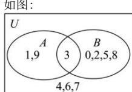

> [!success]- 全练一本通
>
> > [!success] **【答案】** ABC
>
> > [!note]- **【解析】**
> > 解析：因为 $U = \{x|x <   10,x\in \mathbf{N}\} = \{0,1,2,3,4,5,6,7,8,9\}$ 因为 $A\cap (\complement_U B) = \{1,9\}$ ，所以集合 $A$ 中有，集合 $B$ 中无的元素只有1，9；因为 $(_{U}A)\cap (_{U}B) = \{4,6,7\} = _U(A\cup B)$ ，所以既不在集合 $A$ 中，也不在集合 $B$ 中的元素只有4，6，7；因为 $A\cap B = \{3\}$ ，所以集合 $A$ 与 $B$ 的公共元素只有3；所以集合 $B$ 中有，集合 $A$ 中无的元素只有0，2，5，8，即 $B\cup (\complement_U A) = \{0,2,5,8\}$
> >
> > 如图:
> >
> > 
> >
> > 所以： $8 \in B, 9 \in A \Rightarrow \{9\} \subseteq A$ ，故 AC 正确；
> >
> > 因为集合 A 中有 3 个元素, 所以 A 的不同子集的个数为 8, 故 B 正确; 因为 $6 \in \complement_{U}(A \cup B)$ , 故 D 错误.
> >
> > 故选 **ABC**
