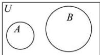

> [!success]- 全练一本通
>
> > [!success] **【答案】** B
>
> > [!note]- **【解析】**
> > 解析：由题意知 $A \subseteq C_{U}B$ ，从而可得 Venn 图如下图，对 A、D: 由 Venn 图, 可得 $B \cap A = \varnothing$ ，故 A、D 错误；对 B: 因为 $B \cap A = \varnothing$ ， $B \subseteq C_{U}A$ 正确，故 B 正确；对 C: 因为 $B \cap A = \varnothing$ ，则 $_{U}A \subseteq _{U}B$ 错误，故 C 错误；
> >
> > 故选:B.
> >
> > 
