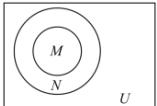

> [!success]- 全练一本通
>
> > [!success] **【答案】** C
>
> > [!note]- **【解析】**
> > 解析：全集 U, 集合 M, N 满足 $M \subseteq N \subseteq U$ , 绘制 Venn 图, 如下:
> >
> > 
> >
> > 对于 A: $M \cup N = N$ , A 错误; 对于 B: $\left(_{U}M\right) \cap (_{U}N) = _{U}N$ , B 错误;
> > 对于 C: $M \cap (\complement_{U} N) = \varnothing$ , C 正确; 对于 D: $\left(_{U}M\right) \cup (_{U}N) = _{U}M$ ; D 错误;
> >
> > 故选 **C**.
