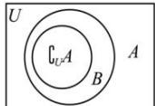

> [!success]- 全练一本通
>
> > [!success] **【答案】** D
>
> > [!note]- **【解析】**
> > 解析：由 A, B 是全集 U 的两个非空真子集, $\left(\complement_{U}A\right)\cup B=B$ , 得 $\complement_{U}A\subseteq B$ ,
> > 如图, 当 $\complement_{U}A \neq B$ 时, $A \cap B \neq \varnothing$ , A 错误;
> >
> > 
> >
> > 观察图形 $A \cap B \neq B$ ， $A \cup B = U \neq A$ ，BC错误；由 $\complement_U A \subseteq B$ ，得 $\complement_U B \subseteq A$ ，因此 $(\complement_U B) \cup A = A$ ，D正确.
> >
> > 故选 **D**
