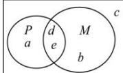

> [!success]- 全练一本通
>
> > [!success] **【答案】** D
>
> > [!note]- **【解析】**
> > 解析：由题意画出Venn图如下，
> >
> > 
> >
> > 可得： $P = \{a,d,e\}$ ， $M = \{b,d,e\}$ ， $P\cap M = \{d,e\}$ ， $P\bigcup M = \{a,b,d,e\}$ .
> >
> > 故选 **D**.
