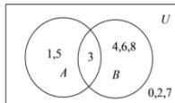

> [!success]- 全练一本通
>
> > [!success] **【答案】** $\{1,3,5\}$
>
> > [!note]- **【解析】**
> > 解析：由题意得 $\left(_{U}A\right)\cup\left(_{U}B\right)=\left\{0,1,2,4,5,6,7,8\right\}$ ,
> > 又 $_{U}\left(A\cap B\right)=\left(_{U}A\right)\cup\left(_{U}B\right)$ ，故 $\complement_{U}\left(A\cap B\right)=\left\{0,1,2,4,5,6,7,8\right\}$ 又 $A \cap B = \{3\}$ ，故 $U = \{0, 1, 2, 3, 4, 5, 6, 7, 8\}$ ，且 $3 \in A, 3 \in B$ ，
> > 因为 $(\complement_{U}A)\cap B=\{4,6,8\}$ ，故 $4,6,8\notin A,4,6,8\in B$ 因为 $A \cap (\complement_{U}B) = \{1, 5\}$ ，故 $1, 5 \in A, 1, 5 \notin B$ 综上： $A=\{1,3,5\}$ ，画出韦恩图如下：
> >
> > 
> >
> > 故答案为： $\{1,3,5\}$
