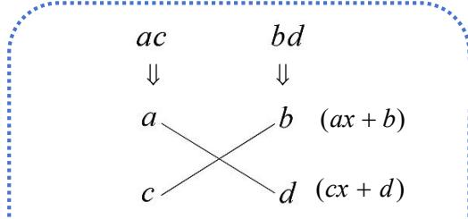

## 知识导学

## 1. 等式的基本性质

<table><tr><td></td><td>名称</td><td>性质内容</td></tr><tr><td>性质1</td><td>对称性</td><td>如果a=b,那么b=a</td></tr><tr><td>性质2</td><td>传递性</td><td>如果a=b,b=c,那么a=c</td></tr><tr><td>性质3</td><td>同加(减)性</td><td>如果a=b,那么a±c=b±c</td></tr><tr><td>性质4</td><td>同乘性</td><td>如果a=b,那么ac=bc</td></tr><tr><td>性质5</td><td>同除性</td><td>如果a=b,c≠0,那么 $\frac{a}{c}=\frac{b}{c}$ </td></tr></table>

## 2. 恒等式

（1）含义:一般地,含有字母的等式,如果其中的字母取任何实数时等式都成立,则称其为恒等式,也称等式两边恒等.

## (2) 重要的恒等式公式

①平方差公式: $(a+b)(a-b)=a^{2}-b^{2}$ ;

②完全平方公式: $\left(a\pm b\right)^{2}=a^{2}\pm2ab+b^{2}$ ;

③立方和公式: $(a+b)(a^{2}-ab+b^{2})=a^{3}+b^{3}$ ;

④立方差公式: $(a-b)(a^{2}+ab+b^{2})=a^{3}-b^{3}$ ;

⑤三数和平方： $(a + b + c)^2 = a^2 +b^2 +c^2 +2ab + 2bc + 2ca$

⑥完全立方: $(a\pm b)^{3}=a^{3}\pm3a^{2}b+3ab^{2}\pm b^{3}$ .

## 3. 方程的解集

（1）方程的解集: 把一个方程所有解组成的集合称为这个方程的解集.

（2）方程组的解集:一般地,将多个方程联立,就能得到方程组,方程组中,由每个方程解集得到的交集称为这个方程组的解集.

（3）二元一（二）次方程组的解集表示方法为： $\left\{(x,y)\mid(a,b),\ldots\right\}$ ，其中a，b为确定的实数.

三元一次方程组解集的表示方法为： $\{(x,y,z)\mid (a,b,c),\ldots \}$ ，其中 $a,b,c$ 为确定的实数.

## 4. 多项式因式分解

## (1) 公式法分解因式

直接通过平方差，完全平方，立方和，立方差等常见的恒等式进行分解因式.

## (2) 十字相乘分解因式

十字相乘法分解二次三项式的步骤：

①把二次项系数和常数项分别拆分成两个数的积；

②尝试选择十字图, 把十字线两端的数相乘后再相加, 使它们的和等于一次项系数;

③根据十字图上下两行的数写出两个因式再相乘.

$$
E x ^ {2} + F x + G = (a x + b) (c x + d)
$$

(其中 E = ac, G = bd, F = ad + bc)

交叉相乘的和为一次项系数 $ad + bc$

## （3）用分组分解法分解因式

利用分组来分解因式的方法，此法的关键是选组适当，合理分组.

## （4）用拆项、补项法分解因式

把多项式的某一项拆开或补上互为相反数的两项（或几项），使原式适合用提公因式法、公式法或分组分解法进行分解．前提是：必须在与原多项式相等的原则下进行变形.

## 5. 一元二次方程的解集

（1）当方程为 $ax^2 + bx + c = 0 (a \neq 0)$ 时， $\Delta = b^2 - 4ac$ 的符号情况决定了方程的解集情况：

（2）当 $\Delta = b^2 - 4ac > 0$ 时，方程的解集为 $\left\{\frac{-b + \sqrt{b^2 - 4ac}}{2a}, \frac{-b - \sqrt{b^2 - 4ac}}{2a}\right\}$

（3）当 $\Delta = b^{2} - 4ac = 0$ 时，方程的解集为 $\left\{-\frac{b}{2a}\right\}$ ;

（4）当 $\Delta = b^{2} - 4ac < 0$ 时，方程的解集为 $\varnothing$ .

## 6. 一元二次方程根与系数的关系（韦达定理）

（1）当一元二次方程 $ax^{2} + bx + c = 0 (a \neq 0)$ 的解集不是空集时，这个方程的解可以记为 $x_{1}, x_{2}$ ，则 $x_{1}, x_{2}$ 满足： $x_{1} + x_{2} = -\frac{b}{a}, x_{1}x_{2} = \frac{c}{a}$ .

（2）常见的涉及到一元二次方程两根 $x_{1}$ 、 $x_{2}$ 的代数式的重要变形：

$$
① x _ {1} ^ {2} + x _ {2} ^ {2} = (x _ {1} + x _ {2}) ^ {2} - 2 x _ {1} x _ {2}
$$

$$
② \frac {1}{x _ {1}} + \frac {1}{x _ {2}} = \frac {x _ {1} + x _ {2}}{x _ {1} x _ {2}}
$$

$$
③ \frac {1}{x _ {1} ^ {2}} + \frac {1}{x _ {2} ^ {2}} = \frac {x _ {1} ^ {2} + x _ {2} ^ {2}}{x _ {1} ^ {2} x _ {2} ^ {2}} = \frac {\left(x _ {1} + x _ {2}\right) ^ {2} - 2 x _ {1} x _ {2}}{x _ {1} ^ {2} x _ {2} ^ {2}}
$$

$$
④ \frac {x _ {2}}{x _ {1}} + \frac {x _ {1}}{x _ {2}} = \frac {x _ {1} ^ {2} + x _ {2} ^ {2}}{x _ {1} x _ {2}} = \frac {\left(x _ {1} + x _ {2}\right) ^ {2} - 2 x _ {1} x _ {2}}{x _ {1} x _ {2}}
$$

$$
⑤ (x _ {1} - x _ {2}) ^ {2} = (x _ {1} + x _ {2}) ^ {2} - 4 x _ {1} x _ {2}
$$

$$
⑥ (x _ {1} + k) (x _ {2} + k) = x _ {1} x _ {2} + k (x _ {1} + x _ {2}) + k ^ {2}
$$

$$
⑦ \left| x _ {1} - x _ {2} \right| = \sqrt {\left(x _ {1} - x _ {2}\right) ^ {2}} = \sqrt {\left(x _ {1} + x _ {2}\right) ^ {2} - 4 x _ {1} x _ {2}}
$$

## 7. 求一元二次方程解集的方法

（1）直接开平方法:利用平方根的定义直接开平方求一元二次方程的解;

（2）配方法:通过方程的简单变形,将左边配成一个含有未知数的完全平方式,若右边是一个非负常数,则可以直接开平方求解;

（3）公式法：将一元二次方程中的系数 $a, b, c$ 的值代入式子 $x = \frac{-b \pm \sqrt{b^2 - 4ac}}{2a}$ 中求解；

（4）因式分解法:通过移项将等式右边变成0,再因式分解,令每个因式为0即可求解.
