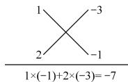
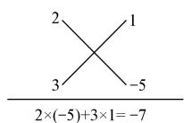
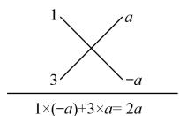

> [!success]- 全练一本通
>
> > [!success] **【答案】** 见解析
>
> > [!note]- **【解析】**
> > 解析：（1）原式 $= x^{2} + \left[(-2) + (-3)\right]x + (-2)\times (-3)$ $= [x + (-2)][x + (-3)] = (x - 2)(x - 3)$ （2）原式 $= x^{2} + (-5 + 3)x + (-5)\times 3 = (x - 5)(x + 3)$ （3）原式 $= x^{2} + (1 + 3)x + 1\times 3 = (x + 1)(x + 3)$ （4） $2x^{2} - 7x + 3$
> >
> > 
> >
> > 故原式 $= (x - 3)(2x - 1)$ （5） $-6a^{2} + 7a + 5$
> >
> > 
> >
> > 
> >
> > 故原式 $= -(a^2 - 7a - 5) = -(2a + 1)(3a - 5)$ (6) $3x^{2} + 2ax - a^{2}$ $\frac{1}{1 \times (-a) + 3 \times a = 2a}$ 故原式 $= (x + a)(3x - a)$ . (7) $3x^{2} + 5xy + 2y^{2}$ . $\frac{x}{3xy + 2xy} = 5xy$ 故原式 $= (x + y)(3x + 2y)$ .
