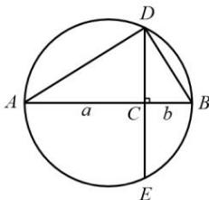

## 知识导学

## 1. 基本不等式

如果 $a > 0, b > 0$ ，则 $\frac{a + b}{2} \geq \sqrt{ab}$ （当且仅当 $a = b$ 时取“=”）。通常这个不等式为基本不等式。

## 2. 算数平均数与几何平均数

给定两个正数 $a, b, \frac{a + b}{2}$ 称为 $a, b$ 的算术平均值； $\sqrt{ab}$ 称为 $a, b$ 的几何平均值.

基本不等式表明:两个正数的算数平均数不小于他们的几何平均数.

## 3. 基本不等式的推导过程

(1) 几何法:

如图, $AB$ 是圆的直径, 点 $C$ 是 $AB$ 上一点, $AC = a, BC = b$ . 过点 $C$ 作垂直于 $AB$ 的弦 $DE$ , 连接 $AD, BD$ . 可证 $\triangle ACD \sim \triangle DCB$ , 因而 $CD = \sqrt{ab}$ . 由于 $CD$ 小于或等于圆的半径, 用不等式表示为 $\sqrt{ab} \leqslant \frac{a + b}{2}$ . 显然, 当且仅当点 $C$ 与圆心重合, 即 $a = b$ 时, 上述不等式的等号成立.

(2) 代数法:

对于实数 $a, b \in R$ ，有不等式 $(a - b)^{2} \geq 0$ （当且仅当 a = b 时取等号 “=”）恒成立.

即 $a^2 + b^2 - 2ab \geq 0$ ，可得 $a^2 + b^2 \geq 2ab$

特别的, 如果 a > 0, b > 0, 我们用 $\sqrt{a}$ 、 $\sqrt{b}$ 分别代替 a、b, 可得: $\left(\sqrt{a}\right)^{2} + \left(\sqrt{b}\right)^{2} \geq 2\sqrt{a}\sqrt{b}$ 即 $a + b \geq 2\sqrt{ab}$ （当且仅当 a = b 时取等号 “=”）

故可得: 如果 a > 0, b > 0，则 $\frac{a + b}{2} \geq \sqrt{ab}$ （当且仅当 a = b 时取 “=”）

## 4. 利用基本不等式求最值

（1）在用基本不等式求函数的最值时,要满足三个条件:一正二定三取等.

①一正:各项均为正数;(异号不能使用基本不等式,同负号可先转化为同正,再使用基本不等式)

②二定:含变数的各项的和或积必须有一个为定值;

③三取等:含变数的各项均相等,取得最值.

(2) 积定和最小, 和定积最大

①设 x, y 为正实数, 若 $x + y = s$ （和 s 为定值）, 则当 x = y 时, 积 xy 有最大值, 且这个值为 $\frac{s^{2}}{4}$ .
②设x,y为正实数,若xy=p（积p为定值），则当x=y时，和 $x+y$ 有最小值，且这个值为 $2\sqrt{p}$ .

## 5. 由基本不等式变形得到的常用结论

结论 1: $ab \leq \left( \frac{a + b}{2} \right)^{2} \leq \frac{a^{2} + b^{2}}{2} \quad (a, b \in R)$

证明:由 $a^{2}+b^{2}\geq2ab\left(a,\ b\in R\right)$ ，不等式两侧同时加 2ab，可得 $a^{2}+b^{2}+2ab\geq4ab$ ，即 $(a+b)^{2}\geq4ab$ ，即 $ab\leq\frac{(a+b)^{2}}{4}$ ，故可得 $ab\leq\left(\frac{a+b}{2}\right)^{2}$ ①

由 $a^2 + b^2 \geq 2ab(a, b \in R)$ , 不等式两侧同时加 $a^2 + b^2$ , 可得 $2a^2 + 2b^2 \geq a^2 + 2ab + b^2$ , 即

$2a^{2}+2b^{2}\geq(a+b)^{2}$ ，故可得 $\frac{2a^{2}+2b^{2}}{4}\geq\frac{(a+b)^{2}}{4}$ ，即 $\left(\frac{a+b}{2}\right)^{2}\leq\frac{a^{2}+b^{2}}{2}$ ②

结合①②可得 $ab \leq \left(\frac{a + b}{2}\right)^2 \leq \frac{a^2 + b^2}{2} (a, b \in R)$

结论2: $\sqrt{ab} \leq \frac{a + b}{2} \leq \sqrt{\frac{a^2 + b^2}{2}} (a, b \in R^+)$

证明:由结论1可知 $ab\leq\left(\frac{a+b}{2}\right)^{2}\leq\frac{a^{2}+b^{2}}{2}$ ，当 $a,b\in R^{+}$ ，根据不等式性质的可开方性质，可对该不等式进行开方，可得 $\sqrt{ab}\leq\frac{a+b}{2}\leq\sqrt{\frac{a^{2}+b^{2}}{2}}\quad(a,b\in R^{+})$

结论 3: $\frac{b}{a} + \frac{a}{b} \geq 2$ ( $a, b$ 同号)

证明: 若 a, b 同号, 则 $\frac{b}{a}$ 与 $\frac{a}{b}$ 同正, 根据基本不等式 $a + b \geq 2\sqrt{ab}$ , 可得 $\frac{b}{a} + \frac{a}{b} \geq 2\sqrt{\frac{b}{a} \cdot \frac{a}{b}} = 2$

(当且仅当 $\frac{a}{b}=\frac{b}{a}$ 时取等号“=”）

结论 4: $\frac{b}{a} + \frac{a}{b} \leq -2$ ( $a, b$ 同负)

证明: 若 a, b 同号, 则 $\frac{b}{a}$ 与 $\frac{a}{b}$ 同负, $\frac{b}{a} + \frac{a}{b} = -\left[\left(-\frac{b}{a}\right) + \left(-\frac{a}{b}\right)\right]$ , $\left(-\frac{b}{a}\right)$ 与 $\left(-\frac{a}{b}\right)$ 同正, 根据基本不等式 $a + b \geq 2\sqrt{ab}$ , 可得 $\left(-\frac{b}{a}\right) + \left(-\frac{a}{b}\right) \geq 2\sqrt{\left(-\frac{b}{a}\right) \cdot \left(-\frac{a}{b}\right)} = 2$ , 故 $\frac{b}{a} + \frac{a}{b} = -\left[\left(-\frac{b}{a}\right) + \left(-\frac{a}{b}\right)\right] \leq -2$

结论 5: $a^{2} + b^{2} + c^{2} \geq ab + bc + ca$ ( $a, b, c \in R$ )

证明:由 $a^{2}+b^{2}\geq2ab$ ， $b^{2}+c^{2}\geq2bc$ ， $a^{2}+c^{2}\geq2ac$ ，相加可得 $2a^{2}+2b^{2}+2c^{2}\geq2ab+2bc+2ca$ ，即 $a^{2}+b^{2}+c^{2}\geqab+bc+ca$ 。

## 6. 重要的均值不等式链

若 $a > 0, b > 0$ ，则 $\frac{2}{\frac{1}{a} + \frac{1}{b}} \leq \sqrt{ab} \leq \frac{a + b}{2} \leq \sqrt{\frac{a^2 + b^2}{2}}$ 。（当且仅当 $a = b$ 时取“=”）

即调和平均数 $\leq$ 几何平均数 $\leq$ 算数平均数 $\leq$ 平方平均数

7. 基本不等式的推广

$a^3 + b^3 + c^3 \geqslant 3abc \Rightarrow \left\{ \begin{array}{l} abc \leqslant \left( \frac{a + b + c}{3} \right)^3 \\ abc \leqslant \frac{a^3 + b^3 + c^3}{3} \\ \frac{a + b + c}{3} \geqslant \sqrt[3]{abc} \end{array} \right.$ （ $a, b, c$ 均为正实数，当且仅当 $a = b = c$ 时，等号成立）
