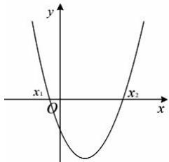
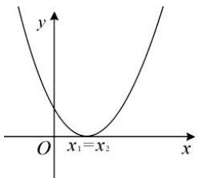
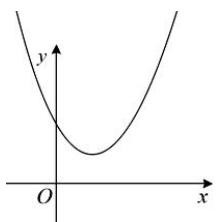

## 知识导学

## 1. 一元二次不等式的相关概念

（1）定义:一般地,只含有一个未知数,并且未知数的最高次数是2的不等式,称为一元二次不等式.

（2）一般形式： $ax^{2}+bx+c>0$ （≥0）， $ax^{2}+bx+c<0$ （≤0），（其中 $a\neq0$ ，a，b，c均为常数）

（3）一元二次不等式的解与解集

使某一个一元二次不等式成立的 $x$ 的值, 叫作这个一元二次不等式的解;

一元二次不等式的所有解组成的集合, 叫作这个一元二次不等式的解集;

将一个不等式转化为另一个与它解集相同的不等式, 叫作不等式的同解变形.

## 2. 二次函数的零点

一般地, 对于二次函数 $y = ax^{2} + bx + c$ , 我们把使 $ax^{2} + bx + c = 0$ 的实数 x 叫做二次函数的零点.

## 3. 二次函数与一元二次方程、不等式的解的对应关系

<table><tr><td colspan="2">判别式 $\Delta = b^{2} - 4ac$ </td><td> $\Delta >0$ </td><td> $\Delta = 0$ </td><td> $\Delta < 0$ </td></tr><tr><td colspan="2">二次函数 $y = ax^{2} + bx + c$  $(a > 0)$ 的图象</td><td></td><td></td><td></td></tr><tr><td colspan="2">方程 $ax^{2} + bx + c = 0$  $(a > 0)$ 的根</td><td>有两个相异实数根 $x_{1,2} = \frac{-b \pm \sqrt{\Delta}}{2a}$ </td><td>有两个相等实数根 $x_{1} = x_{2} = -\frac{b}{2a}$ </td><td>没有实数根</td></tr><tr><td rowspan="2">不等式的解集</td><td> $ax^{2} + bx + c > 0$   $(a > 0)$ </td><td> $\{x | x < x_{1} \text{或} x > x_{2}\}$ </td><td> $\{x | x \neq -\frac{b}{2a}\}$ </td><td> $R$ </td></tr><tr><td> $ax^{2} + bx + c < 0$   $(a > 0)$ </td><td> $\{x | x_{1} < x < x_{2}\}$ </td><td> $\varnothing$ </td><td> $\varnothing$ </td></tr></table>

## 4. 一元二次不等式的解法

（1）判号:检查二次项的系数是否为正值,若是负值,则利用不等式的性质将二次项系数化为正值;

(2) 求根: 计算判别式 $\Delta$ , 求出相应方程的实数根;

① $\Delta > 0$ 时, 求出两根 $x_{1}$ 、 $x_{2}$ , 且 $x_{1} < x_{2}$ （注意灵活运用因式分解和配方法）;

② $\Delta = 0$ 时, 求根 $x_{1} = x_{2} = -\frac{b}{2a}$ ;

③ $\Delta<0$ 时,方程无解

（3）标根: 将所求得的实数根标在数轴上（注意两实数根的大小顺序, 尤其是当实数根中含有字母时），并画出开口向上的抛物线示意图；

（4）写解集:根据示意图以及一元二次不等式解集的几何意义,写出解集.

口诀: 大于零取（根）两边, 小于零取（根）中间.
