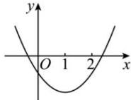

> [!success]- 全练一本通
>
> > [!success] **【答案】** $m < 0$
>
> > [!note]- **【解析】**
> > 解析：如下图, 令 $y = x^{2} - 2x + m$ , 即 y < 0 对任意 $1 \leq x \leq 2$ 恒成立,
> > 需满足 $\left\{\begin{aligned}&1-2+m<0\\ &4-4+m<0\end{aligned}\right.$ 解得 m<0，所以 m 的取值范围为 m<0。
> >
> > 
